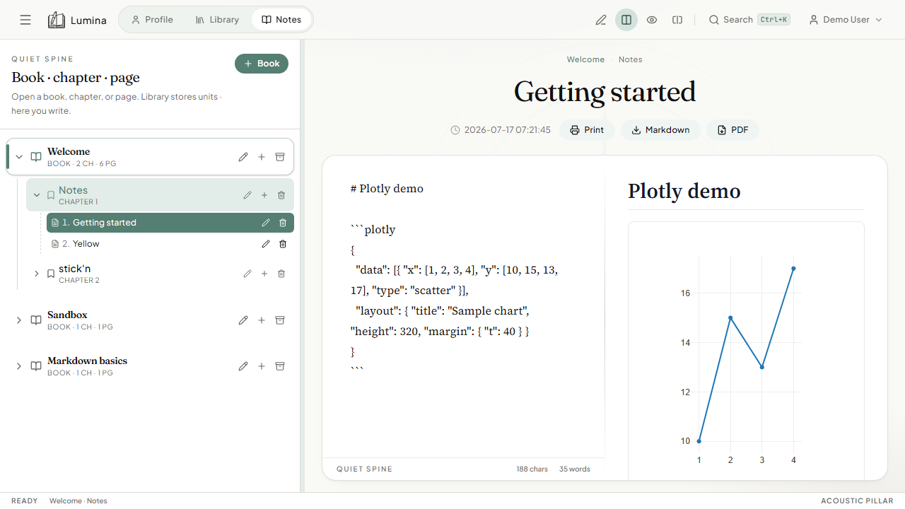

# Desktop app (Electron)



## What it is

Native Windows and macOS apps that wrap the Lumina UI and a local FastAPI + SQLite backend (bundled as `LuminaApi` in production builds). Includes always-on-top [stick'n strips](./sticky-strips.md).

## How to use

### Development

```bash
npm run dev:electron
```

Starts API + Vite + Electron. Sticky window opens with the main window.

### Installer

See [PACKAGING.md](../PACKAGING.md):

```bash
npm run build:win    # Windows
npm run build:mac    # macOS (build on a Mac)
```

Installers land in `release/electron/`.

## How it works

- `electron/main.cjs` creates the main BrowserWindow and sticky window.
- Production serves the built Vite `dist` and spawns the bundled API.
- Dev loads `http://127.0.0.1:5173` with `ELECTRON_DEV=1`.

## Related

- [sticky-strips.md](./sticky-strips.md)
- [sync.md](./sync.md) — point desktop at a shared server URL if you want multi-device data
