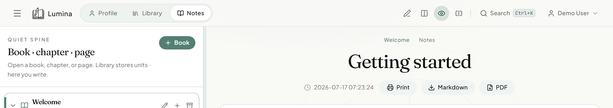
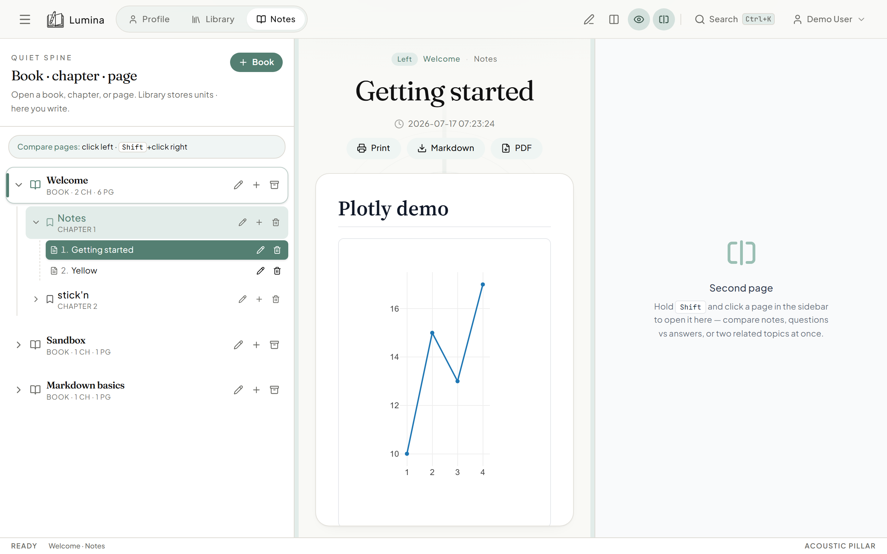

# Edit · Read · Two pages

## What it is

In **Notes**, the top bar controls how you see the current page:

| Control | What it does |
|---------|----------------|
| **Edit** | Source only — full-width Markdown editor |
| **Split** | Editor and live preview side by side (default on wide screens) |
| **Read** | Preview only — rendered page, no editor |
| **Two pages** | Open a second page beside the first for comparison |

On narrow screens the middle **Split** button hides; use **Edit** and **Read** instead.

## How to use

### Edit, Split, and Read

1. Open **Notes** and select a page.
2. Click **Edit**, **Split**, or **Read** in the top bar (pencil, columns, eye icons).
3. Drag the divider between panes in **Split** mode to resize editor vs preview.

### Two pages side by side

1. Click **Two pages** in the top bar (split-rectangle icon).
2. The left pane shows your current page.
3. **Shift+click** another page in the sidebar to open it on the right.
4. Click **Two pages** again to return to a single page.

A hint appears in the sidebar while two-page mode is on: click for the left pane, **Shift+click** for the right.

## Tips

- Compare notes, questions vs answers, or two related topics at once.
- Each pane has its own **Print**, **Markdown**, and **PDF** actions (see [export.md](./export.md)).
- **Read** mode is useful for reviewing finished notes without the editor chrome.

## Limits

**Two pages** is hidden on compact layouts. **Split** is also hidden on small screens — switch between **Edit** and **Read** there instead.
