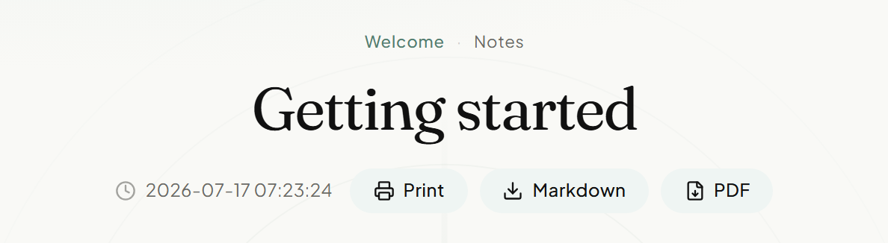

# Print · Markdown · PDF export

## What it is

Every open page has three export actions in the note header (below the title and timestamp):

| Action | Result |
|--------|--------|
| **Print** | Opens a print-friendly window (browser print dialog — printer or “Print to PDF”) |
| **Markdown** | Downloads the page as a `.md` file |
| **PDF** | Downloads an A4 PDF from the rendered preview |

In **Two pages** mode, each pane has its own **Print**, **Markdown**, and **PDF** row (see [editor-views.md](./editor-views.md)).

## How to use

1. Open a page in **Notes**.
2. Under the page title, click **Print**, **Markdown**, or **PDF**.
3. For PDF, wait for generation; save the file when prompted.

## How it works

- Print uses `openPrintWindow` with sanitized HTML from the preview.
- Markdown uses a client-side download of title + content.
- PDF uses HTML → PDF (html2pdf / Electron printToPDF on desktop when available).

## Limits

Very large pages, complex Mermaid, or heavy Plotly charts may not rasterize perfectly in PDF. Prefer Print → system PDF for tricky pages.
