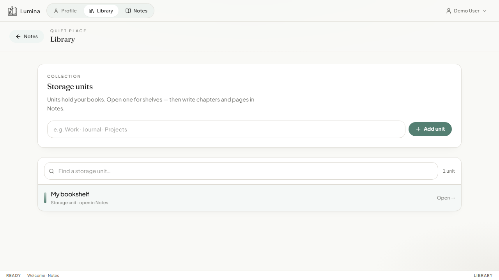
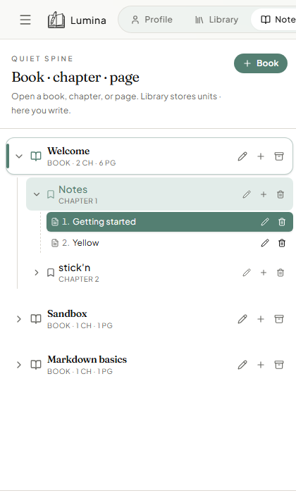

# Books · chapters · pages

## What it is

OneNote-style organization:

| Level | In the UI | Role |
|-------|-----------|------|
| Bookshelf | **Library** | Collection of notebooks |
| Notebook | Book | Top-level binder |
| Section | Chapter | Group of pages |
| Page | Page | One Markdown document |

Hierarchy is fixed at these four levels (not arbitrary nesting).

## How to use

### Library

1. Open **Library**.
2. Create or open a bookshelf.
3. Open a notebook into **Notes**.

### Notes sidebar

1. **+ Book** — create a notebook on the active shelf.
2. On a book: add a **chapter** (section).
3. On a chapter: add a **page**.
4. Rename or delete with the pencil / trash controls.
5. Click a page to open it in the editor.

### Dual page (optional)

Where enabled, you can open a second page beside the first for comparison.

## How it works

State is loaded from the FastAPI (`notebooks`, `sections`, `pages`). The sidebar mirrors that tree; edits call the REST API and update local React state.
