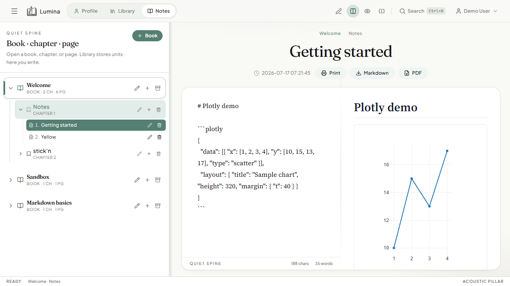

# Markdown editing & live preview



## What it is

Lumina is Markdown-first. Each page is a Markdown document with:

- **Edit** — write source in the left pane
- **Split** — edit and live preview side by side (default)
- **Read** — preview only

GitHub Flavored Markdown (GFM) is supported via `remark-gfm` (tables, strikethrough, task lists, autolinks).

## How to use

1. Open **Notes** and select a page in the sidebar.
2. Use the toolbar icons: **Edit**, **Split**, or **Read**.
3. Type Markdown in the editor. The preview updates as you type.
4. Title the page in the header field above the editor.

### Useful syntax

```markdown
# Heading
**bold** and *italic*
- [ ] task
- [x] done

| Col A | Col B |
|-------|-------|
| one   | two   |
```

## Tips

- Word/character count appears under the editor.
- Export the rendered page with **Print**, **Markdown**, or **PDF** (see [export.md](./export.md)).
- Diagrams and charts use fenced code blocks — see [mermaid.md](./mermaid.md) and [plotly.md](./plotly.md).

## Limits

Code blocks are monospace; dedicated syntax highlighting themes are not included yet.
