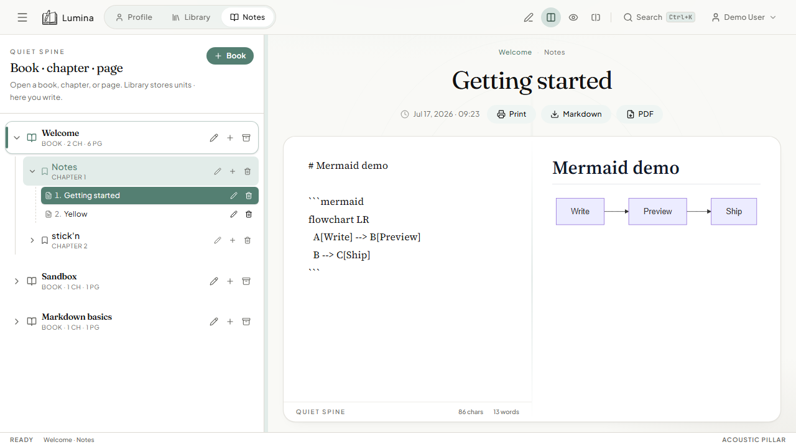
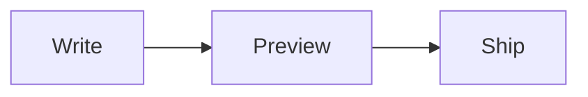

# Mermaid diagrams



## What it is

Fenced `mermaid` code blocks render as diagrams in the live preview (flowcharts, sequence diagrams, Gantt, and other Mermaid types supported by the bundled Mermaid library).

## How to use

1. Open a page in **Split** or **Read** mode.
2. Add a Mermaid fence in the editor:

````markdown

````

3. The preview draws the diagram. Invalid Mermaid shows an error in place of the chart.

### Desktop stickies

On the Electron sticky writer, use **+ Mermaid** to insert a starter snippet, then save — the same page updates in the main app.

## How it works

`Preview.tsx` detects `language-mermaid` fences and mounts the `Mermaid` React component, which calls the Mermaid runtime to SVG.

## Tips

- Keep diagrams small for PDF export; very large graphs may clip.
- Prefer `flowchart` / `sequenceDiagram` for notes; exotic layouts can be heavy on mobile.
