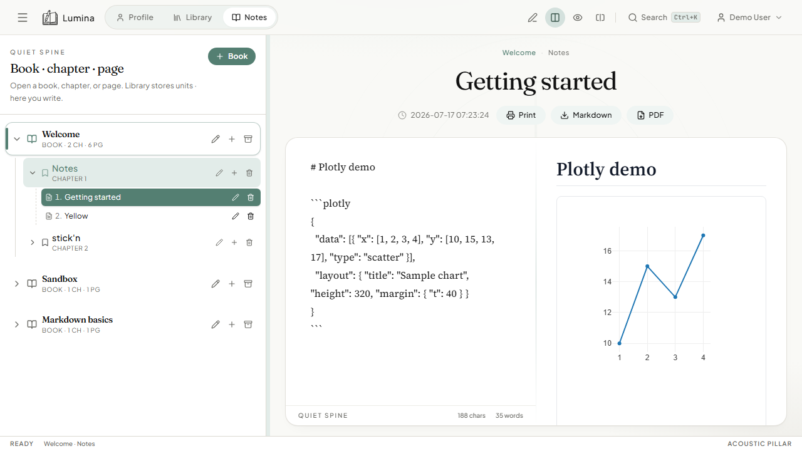

# Phone & tablet (PWA)



## What it is

Lumina installs as a Progressive Web App (service worker + web manifest via `vite-plugin-pwa`). You can also build an Android APK with Capacitor.

## How to use

### Install from the browser

1. Open the deployed site (or local `npm run dev`) on your phone.
2. Use the browser **Add to Home Screen** / install prompt (Chrome, Edge, Safari share sheet on iOS).
3. Sign in and set **Profile → Devices & sync** to your API URL (phones do not run the Python API).

### Android APK

```bash
npm run build:apk
```

Details: [PACKAGING.md](../PACKAGING.md).

## How it works

- `VitePWA` registers a service worker for offline shell caching.
- `InstallPrompt.tsx` surfaces install UX when the browser allows it.
- Capacitor wraps the same web build for Play-style sideloading.

## Tips

- Configure `CORS_ORIGINS` on the server to include Capacitor (`https://localhost`) and your PWA origin.
- Use HTTPS in production so install and service workers work reliably.
