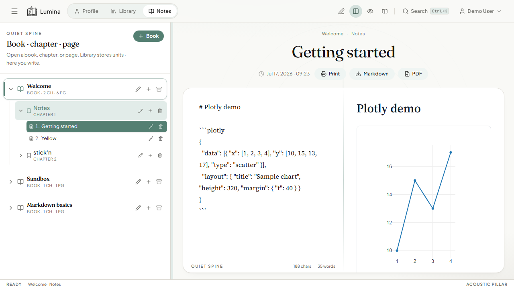

# Plotly charts



## What it is

Fenced `plotly` blocks embed interactive Plotly charts inside notes. Chart JSON is the standard Plotly figure shape (`data` + optional `layout`).

## How to use

1. Open a page in **Split** or **Read** mode.
2. Paste a Plotly figure as JSON inside a fence:

````markdown
```plotly
{
  "data": [{ "x": [1, 2, 3, 4], "y": [10, 15, 13, 17], "type": "scatter" }],
  "layout": { "title": "Sample chart", "height": 320 }
}
```
````

3. The preview renders an interactive chart (zoom/pan where Plotly supports it).

## How it works

`Preview.tsx` routes `language-plotly` fences to `PlotlyChart.tsx` (`react-plotly.js`). Available to all users (not a paid tier).

## Tips

- Keep `layout.height` modest for readable notes and PDF export.
- Invalid JSON shows an error; validate the figure in [plotly.com](https://plotly.com/javascript/) if needed.
- Large Plotly bundles affect first load — the app still works offline after install/cache.
