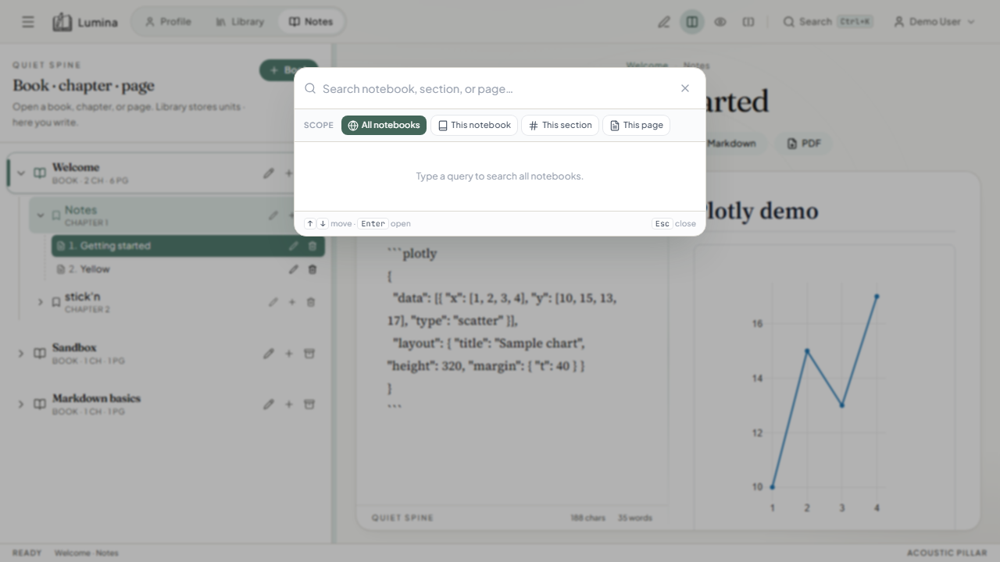

# Quick search

## What it is

Jump to any notebook, section, or page without scrolling the sidebar.

## How to use

1. Press **Ctrl+K** (⌘K on macOS), or click **Search** in the top bar.
2. Type part of a book, chapter, or page title.
3. Use arrow keys / click a result to open it.
4. **Esc** closes the panel.

## How it works

`SearchPanel` filters the in-memory notebook tree (titles). Navigation updates the active notebook / section / page ids in app state.

## Tips

- Search is local to the loaded shelf — switch shelves in **Library** first if you cannot find a book.
- Results update as you type; no separate server search index.
