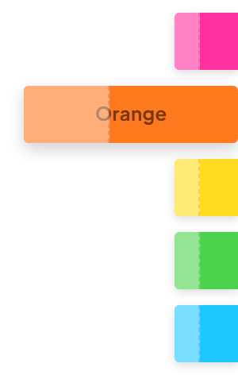
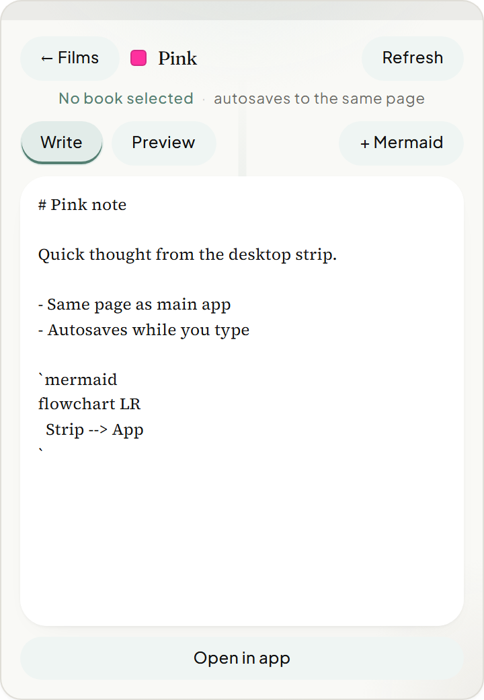

# stick'n neon sticky strips

## What it is

Desktop-only (Electron) always-on-top neon film strips. Each colour maps to a shared notebook page so typing on a strip updates the same page in the main window (and vice versa).

## How to use

1. Run the desktop app: `npm run dev:electron` or install from `release/electron/`.
2. Open **Profile → Sticky note strips** and pick the target book.
3. Use the neon tabs on the desktop edge — hover to peek, click to write.
4. Type in the strip editor; content autosaves and mirrors to the main app when that page is open.
5. Optional: **Open in app** focuses the page in the main window.

### Colours

Pink, Orange, Yellow, Green, Blue — each can bind to its own page (by title or stored page id).

## How it works

- Sticky UI loads at `?desktop=1&sticky=1`.
- Saves go through the same FastAPI `pages.update` as the main editor.
- Live mirror uses Electron IPC (`lumina:page-sync`) between the sticky window and the main window — no Kafka or external queue.

## Requirements

Electron desktop build. The web/PWA profile may hide or limit sticky configuration; full strips need the desktop shell.
