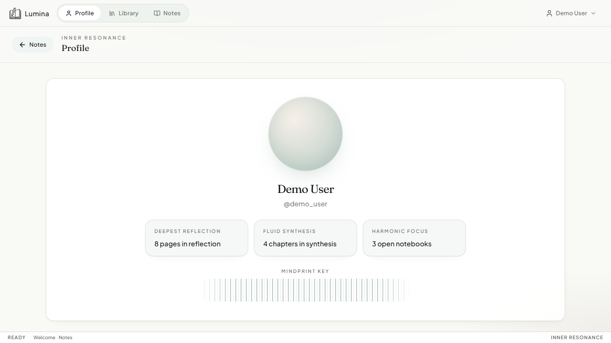

# Devices & sync

## What it is

Free multi-device sync by pointing every client at **your** FastAPI URL. There is no Lumina-hosted cloud and no Supabase requirement.

## How to use

1. Run one shared API (Docker on a VPS, home lab, Railway, Fly.io, etc.).
2. On each device open **Profile → Devices & sync**.
3. Paste the API base URL (e.g. `https://notes.example.com` or `http://192.168.1.10:58888`).
4. **Test & save**, then sign in with the **same account**.

Leave the URL empty on the Windows/macOS installer to keep using the **local** bundled SQLite database.

## How it works

- Clients store the sync base URL and send JWT-authenticated REST calls to that host.
- Server stacks can use Postgres (`DATABASE_URL`); desktop default is SQLite.
- Set `CORS_ORIGINS` on the server to allow your web/PWA/Capacitor origins.

## Security notes

- Passwords are hashed (bcrypt); use HTTPS in production.
- Note bodies are stored as text in your database — encrypt the disk/volume and protect the server.
- Set a strong `JWT_SECRET` and `LUMINA_ENV=production` for public deployments.

More packaging detail: [PACKAGING.md](../PACKAGING.md).
