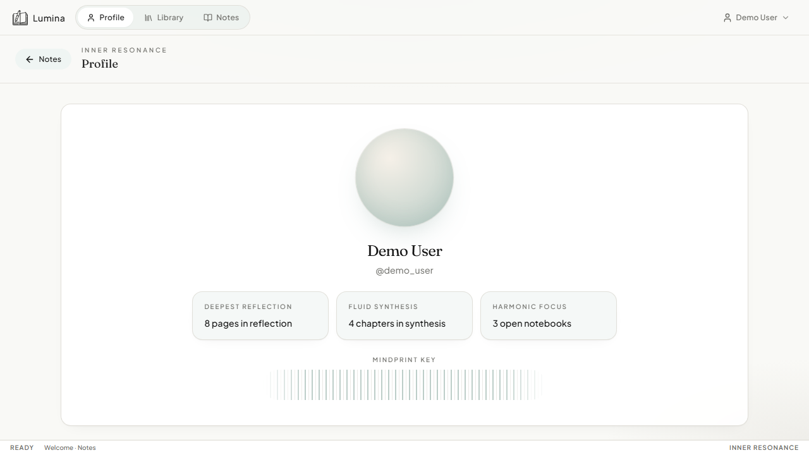

# Devices & sync

## What it is

Free multi-device sync by pointing every client at **your** FastAPI URL. There is no Lumina-hosted cloud and no Supabase requirement.

## How to use

1. Run one shared API (Docker on a VPS, home lab, Railway, Fly.io, etc.).
2. On each device open **Profile → Devices & sync**.
3. Paste the API base URL (e.g. `https://notes.example.com` or `http://192.168.1.10:58888`).
4. **Test & save**, then sign in with the **same account**.

Leave the URL empty on the Windows/macOS installer to keep using the **local** bundled SQLite database.

## How it works

- Clients store the sync base URL and send JWT-authenticated REST calls to that host.
- Server stacks can use Postgres (`DATABASE_URL`); desktop default is SQLite.
- Set `CORS_ORIGINS` on the server to allow your web/PWA/Capacitor origins.

## Flutter mobile app (offline + sync)

The Flutter app in [`mobile/`](../../mobile/README.md) is the primary phone/tablet client.
Unlike the PWA, it keeps a **local database** on the device:

- Reading and editing work with **no network** (airplane mode included).
- Every change is queued and pushed when the server is reachable. The app
  syncs at start, when the network comes back, when you return to the app,
  ~2 s after an edit, and every minute. The chip in the app bar shows
  **Synced / Syncing / Offline / Sync error / Sign in again**.
- Electron keeps using the server online. Use the **same server URL and
  account** on both, and changes flow both ways.

### Conflicts (v1: last-write-wins)

- If you edit something on the phone and nobody changed it on the server since
  the phone last synced it, your edit wins.
- If both sides changed it, the **later edit wins** (compared by timestamp);
  the losing device adopts the winner on its next sync. There is no merge UI yet.
- Deleting a notebook on one device while editing its pages on another: the
  delete wins and the orphaned pages are removed.
- Timestamps come from device clocks, so keep phone/PC time on automatic.

### Server endpoints (additive)

| Endpoint | Purpose |
|----------|---------|
| `GET /api/sync/changes?since=<cursor>` | Rows changed since the cursor + deletions (tombstones) |
| `POST /api/sync/push` | Apply queued ops; per-op `applied` / `stale` / `rejected` with the server's current row |

`updatedAt` and tombstones are maintained by database triggers (SQLite and
Postgres), so edits made through the existing routes (Electron, web, backup
import) show up in the change feed. Existing routes are unchanged.

## Security notes

- Passwords are hashed (bcrypt); use HTTPS in production.
- Note bodies are stored as text in your database — encrypt the disk/volume and protect the server.
- Set a strong `JWT_SECRET` and `LUMINA_ENV=production` for public deployments.

More packaging detail: [PACKAGING.md](../PACKAGING.md).
